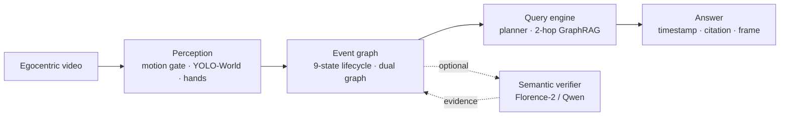

# Chronicle

**Grounded, auditable episodic memory for egocentric video.**

[](https://www.python.org/)
[](LICENSE)
[](docs/RESEARCH_RESULTS.md)

Chronicle turns a first-person video into a compact, queryable memory: an
event-gated object/state graph with timestamps, spatial relations, lifecycle
states, and evidence. Questions are answered from that memory, not by
re-watching the video.

The Python distribution is **`chronicle-memory`**; the import package and
command remain **`chronicle`**. This avoids the unrelated `chronicle` package
already on PyPI.

The design goal is **not** another video chatbot. It is a memory substrate that
can answer grounded questions deterministically, cite its evidence, and call a
vision-language model only when it adds value.

## Why Chronicle

- **Compile once, query many.** A 15-minute video becomes a small memory.
  Repeated questions do not re-decode the video or re-run a video model.
- **Auditable answers.** Every answer carries a timestamp, a relation, and a
  citation. Unknown entities return an explicit “I don’t have that in my
  memory” instead of a plausible guess.
- **VLM optional.** On the grounded QA suite, Florence-2 captions can be
  disabled without changing accuracy. The deterministic semantic verifier still
  runs; see the research notes for the exact distinction.
- **Built for egocentric video.** Motion gating suppresses redundant frames,
  hands and objects are tracked through occlusion, and object state is modelled
  over time rather than per frame.

## What it does

```text
video ──► perception ──► event graph ──► query planner ──► answer
          motion gate    9-state lifecycle   intent + graph    text + timestamp
          YOLO-World     dual graph         2-hop GraphRAG    + citation + frame
          hands/tracks   SQLite projection  optional VLM
```

Given a question such as *“Where are my keys?”*, Chronicle returns the last
known location, the time it was observed, and the evidence used. For
event-centric questions it can count instances, resolve aliases, and answer
first-touch / destination / inventory queries from graph structure.

## Architecture



| Layer | What it does |
|---|---|
| Perception | Background-masked motion, open-vocabulary detection, hand landmarks, tracking with re-ID, appearance attributes |
| Memory | Nine-state object lifecycle, support/containment relations, background anchors + foreground events, SQLite projection |
| Semantics | Event-triggered clip verification, action/state evidence, optional captioning |
| Query | Deterministic planner, 2-hop GraphRAG retrieval, alias-aware entity resolution, explicit abstention |
| Interface | CLI, Python API, NiceGUI dashboard, JSON/CSV/ZIP exports |

## Try it in 60 seconds

The first-run path is deliberately model-free. You do **not** need a GPU, a
video file, YOLO weights, Florence-2, or the dashboard:

```bash
python -m venv .venv
source .venv/bin/activate
pip install "git+https://github.com/g1gowda123/chronicle.git@main"

chronicle doctor
chronicle demo
chronicle ask "where is my cup?"
```

Until the first PyPI release, install the current release from `main`. To work
on the code, clone the repository and run `pip install -e ".[dev]"` (see
[Development](#development)).

`chronicle demo` generates a 4.6-second synthetic pick-and-place scene, compiles
it into SQLite, runs location/event queries, and reopens the database to prove
that the answer survives a process restart. `chronicle ask` without `--db`
loads the same memory bundled with the package.

`chronicle doctor` checks the core install, optional feature layers, CUDA, model
weights, and the bundled memory. It exits non-zero only when something required
is missing.

| Command | Models required | Purpose |
|---|---|---|
| `chronicle demo` | none | Generate and query a synthetic memory |
| `chronicle ask` | none (template answerer) | Query the bundled or persisted memory |
| `chronicle doctor` | none | Diagnose install, CUDA, weights, demo data |
| `chronicle sources` | none | List bundled/demo video sources |
| `chronicle run` | perception extra | Ingest a real video |
| `chronicle serve` | UI extra | Launch the optional dashboard |

### Optional feature layers

The core install contains the memory, graph, query engine, CLI, and demo. Add
only the layer you need:

From a source checkout:

```bash
pip install ".[perception]"       # YOLO-World, MediaPipe, OpenCLIP, torch
pip install ".[semantic-models]"  # Florence-2 / local transformer models
pip install ".[ui]"               # NiceGUI dashboard (`chronicle serve`)
```

If you installed the package from GitHub instead, use the same extras on the
distribution name, for example:

```bash
pip install "chronicle-memory[perception] @ git+https://github.com/g1gowda123/chronicle.git@main"
```

The UI is intentionally not a core dependency. `chronicle run`, `ask`, `demo`,
`sources`, and `doctor` all work without NiceGUI, FastAPI, or a browser.

Event-clip verification additionally uses `ffmpeg` to extract the pre/contact/
post audit frames. Install it at the system level; `chronicle demo` does not
need it.

### Perception demo

```bash
pip install ".[perception]"
python scripts/fetch_assets.py
python scripts/make_demo.py
python -m chronicle.perception data/demo/chronicle_demo.mp4 \
  --detector color --hands color --embedder color \
  --jsonl runs/demo.jsonl --clips-dir runs/demo_clips
```

### Dashboard (optional)

```bash
pip install ".[ui]"
./chronicle.sh preflight
chronicle serve --source synthetic --auto-run
# open http://127.0.0.1:8080
```

### Semantic + GraphRAG evaluation

```bash
pip install ".[semantic-models]"
ollama pull qwen2.5:7b-instruct
python -m chronicle.semantic.evaluation
python scripts/benchmark_llm.py --backend all
```

### Development

```bash
pip install -e ".[dev]"
python -m pytest
```

## Benchmarks

GraphRAG answer path on the repository’s deterministic 13-case evaluation set
(location, last-seen time, action, multi-hop, appearance, unknown):

| Answer path | Model | Pass | Citation precision | Latency (mean) | Tokens |
|---|---|---:|---:|---:|---:|
| Deterministic template | — | **100%** | **100%** | 0.00 s | 0 |
| Local LLM | `qwen2.5:7b-instruct` | 77% | **100%** | 0.53 s | 4,546 |
| Cloud LLM | `gemini-2.5-flash-lite` | 77% | **100%** | 1.63 s | 4,835 |

The template path is the evaluation reference, so its 100% is by construction.
Both LLM paths produced **zero crash/hallucinated citations**; missed cases were
scoring-strictness issues, not fabricated facts. See
[`docs/BENCHMARKS.md`](docs/BENCHMARKS.md) for per-family results and the
15-minute-video baseline.

### Research evidence

Controlled results from the research branch (`research/vfm-merged`) on two
egocentric clips:

| System | Cook 45 s | HoloAssist 34 s | Pooled | VLM calls |
|---|---:|---:|---:|---:|
| **Chronicle, event planner** | **80.0%** (8/10) | **87.5%** (7/8) | **83.3%** (15/18) | 26 / 13 |
| Dense 1 FPS baseline | 40.0% (4/10) | 12.5% (1/8) | 27.8% (5/18) | 45 / 34 |
| Leak-free baseline | 40.0% (4/10) | 62.5% (5/8) | 50.0% (9/18) | 53 / 35 |

These are **small, custom diagnostic suites**, not a standard benchmark. The
official zone-token matcher is lenient; a strict support audit gives Cook
location **1/6** rather than 6/6. Full methodology, confidence intervals,
ablations, and caveats are in
[`docs/RESEARCH_RESULTS.md`](docs/RESEARCH_RESULTS.md). EgoTempo and Ego4D
evaluation harnesses live on `experiment/egotempo-benchmark`.

## Repository layout

```text
chronicle/
  perception/     motion gating, detection, hands, tracking, clips
  graph/          lifecycle, dual graph, planner, query, memory
  semantic/       verification, calibration, GraphRAG, evaluation
  storage/        SQLite schema + persistence
  ui/             NiceGUI dashboard (optional extra)
  demo.py         model-free synthetic scene and bundled-memory generator
  demo_data/      bundled SQLite memory used by `chronicle ask`
  doctor.py       environment diagnostics (`chronicle doctor`)
docs/             architecture, contracts, benchmarks, calibration
scripts/          demos, asset fetch, LLM benchmark, evidence fixtures
tests/            model-free unit + integration suite
```

## Documentation

- [Integration and runtime contract](docs/INTEGRATION.md)
- [Perception contract](docs/PERCEPTION.md)
- [Memory and graph contract](docs/ROLE_B.md)
- [Semantic verification contract](docs/ROLE_C.md)
- [GraphRAG benchmarks](docs/BENCHMARKS.md)
- [Action calibration](docs/CALIBRATION.md)
- [Demo preflight](docs/DEMO_PREFLIGHT.md)
- [Research results and audit](docs/RESEARCH_RESULTS.md)

## Status and limitations

Chronicle is a **research framework**, not a production service.

- The controlled QA suites are small (two clips, 18 questions); standard
  benchmark results are still in progress.
- Official location scores are inflated by zone/state answers. The strict
  support audit is reported alongside them.
- Action semantics are limited to the events the geometry/verifier can
  recognise (pickup, placement, containment); fine-grained verbs such as
  slicing or assembling are future work.
- The deterministic semantic verifier matters even when captions are disabled;
  “VLM optional” refers to caption content on grounded questions, not to
  removing the verifier.
- APIs may change before a stable release.

## Citation

If you use Chronicle in research, cite the repository:

```bibtex
@software{chronicle2026,
  title   = {Chronicle: Grounded Egocentric Episodic Memory},
  author  = {{Chronicle contributors}},
  year    = {2026},
  url     = {https://github.com/g1gowda123/chronicle}
}
```

## License

MIT. See [LICENSE](LICENSE). Third-party datasets and model weights retain their
own licenses; Ego4D videos are not redistributed here.
